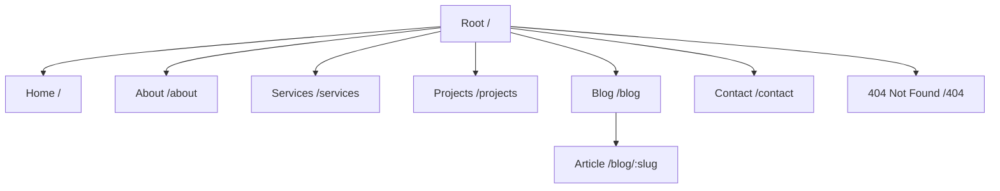

# 05 - Sitemap and Content Architecture

## 1. Route Architecture

---

## 2. Page Specifications & Content Matrix

### 2.1 Home Page (`/`)
1. **Header Capsule Navigation**: Floating pill navigation with Logo, links, and "Get in Touch" glowing button.
2. **Hero Section**:
   - Background Video: `Glowing-particles-overlay_mp4.mp4` with subtle gradient vignette.
   - Micro-Badge: `New • Automated Drone & AI Activations 2026`.
   - Title: `Next-Gen Experiential Technology for Visionary Brands`.
   - Subtitle: `We engineer drone light shows, AI photo booths, robotics, and holographic installations that transform events into unforgettable phygital spectacles.`
   - CTAs: `Explore Solutions` (White) and `Schedule Activation` (Glowing Electric Blue).
   - Social Proof: `Trusted by 100+ Enterprise Brands & Government Entities across the Middle East`.
   - Feature Ticker: `✓ Ignispectra Drone Shows` | `✓ Nexplay AI Photobooths` | `✓ 3D Holographic Visuals` | `✓ Robotic Arms & Activations` | `✓ Gesture Kiosks`.
3. **The Connection (Adam Motif Showcase)**:
   - Visual: Synergy of human creativity and robotic precision.
   - Headline: `Where Technology Meets Emotion`.
   - Client Logos: Showcase of partner brands and exhibitions (GITEX, DWTC, Expo City, Global Village).
4. **Interactive Bento Grid (Core Capabilities)**:
   - 4 asymmetric cards showcasing the 4 core pillars with interactive hover glow effects.
5. **Featured Case Studies Preview**:
   - High-impact visual project highlights with metric tags (`+400% Engagement`, `50k+ Live Impressions`).
6. **Tiered Experience Packages / Solutions**:
   - Activation packages (Exhibition Pod, Flagship Brand Launch, Mega Stadium Drone Show).
7. **Client Testimonials**:
   - Quotes from event directors and enterprise brand managers.
8. **High-Impact CTA Banner & Global Footer**.

### 2.2 About Page (`/about`)
- **Hero**: `Pioneering the Future of Experiential Marketing in Dubai`.
- **Mission & Vision**: Creating multi-sensory experiences that ignite wonder and drive viral brand engagement.
- **Milestones Timeline**: From our founding in Dubai to delivering cutting-edge drone shows and AI activations.
- **Core Pillars**: Innovation, Precision Engineering, Emotional Connection, Flawless Execution.
- **Leadership Team**: Profiles of creative directors, robotics engineers, and visual architects.

### 2.3 Services Page (`/services`)
- **Ignispectra**: Swarm drone light shows, custom aerial typography, 3D animated constellations.
- **Nexplay**: Intelligent AI photo booths, generative style filters, robotic camera rigs.
- **Synapse**: Interactive gesture kiosks, digital buzz-wire challenges, crowd gamification.
- **Lumen Lab**: 3D holographic projection, spatial augmented reality, architectural projection mapping.
- **AI Content Studio**: Real-time social asset generation, generative visuals, algorithmic media synthesis.

### 2.4 Projects / Portfolio Page (`/projects`)
- Filterable gallery: `All`, `Drone Shows`, `AI & Robotics`, `Interactive Kiosks`, `Holograms & AR`.
- Dynamic project cards with category badges, client names, metrics, and project imagery.

### 2.5 Blog & Insights Page (`/blog` & `/blog/[slug]`)
- Editorial articles on the experiential tech industry:
  - *The Future of Aerial Advertising: How Drone Light Shows are Replacing Fireworks*
  - *How AI-Driven Photobooths Generate 10x More Organic Social Impressions*
  - *Phygital Retail: Merging Spatial Computing with Exhibition Spaces*
- Full responsive article view with table of contents, author bio, and related reads.

### 2.6 Contact Page (`/contact`)
- Interactive RFP & Inquiry Form:
  - Full Name, Corporate Email, Phone/WhatsApp, Event Date, Service Category, Estimated Budget, Project Details.
- Instant WhatsApp link (`+971 54 545 4891`).
- Dubai Office Location & Operating Hours.
- Interactive FAQ Accordion.

### 2.7 404 Custom Error Page
- Dark space background with celestial floating coordinate animation.
- Quick navigation return to Home, Services, and Contact.

